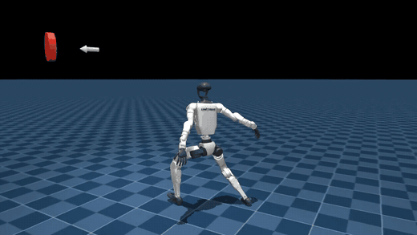
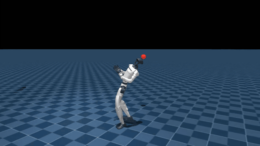
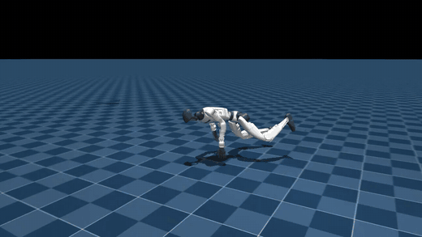
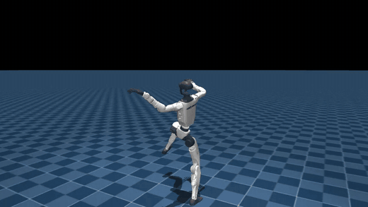
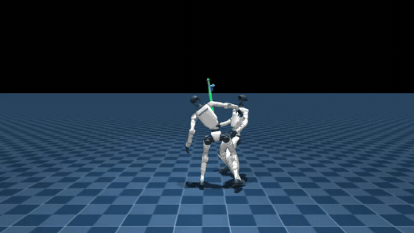
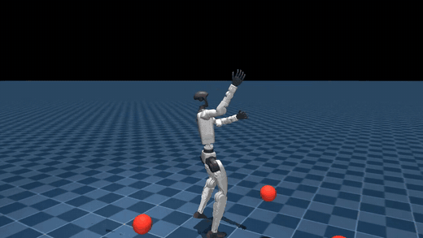
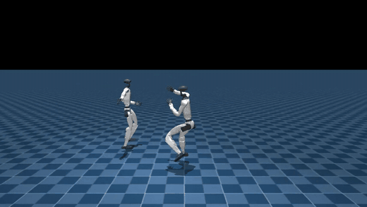
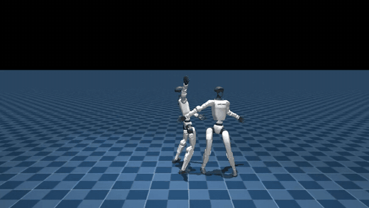
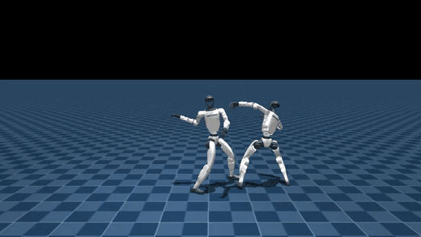

# Engineering log

What was tried, what the numbers were, and what broke. Newest decisions are at the end. All runs are single seeds on
one GPU each unless stated, so small differences between variants may be noise.

## 0. Starting point (11 Nov 2026)

Goal: two simulated Unitree G1 humanoids that fight, with every skill learned from reward. Physics is MuJoCo Warp on a
GPU through mjlab; training is PPO (rsl_rl) with 2,000 to 4,000 robots in parallel; control runs at 50 Hz and the
physics at 200 Hz.

An early track retargeted CMU motion capture (a jab) onto the G1 and trained the robot to track it. It worked as
tracking, but it produces one fixed move per clip, so it was dropped in favour of gyms where the robot is scored on
outcomes. The code is kept in `motions/`.

## 1. One gym per skill

| Gym | Task | Reward in one line | Result |
|---|---|---|---|
| Strike v0 to v2 | A pad appears; hit it with the ordered fist in the ordered direction before it expires | Force along the ordered direction, faster is better, wrong limb is a foul | Reaches full difficulty (pads behind it, out of reach, drifting). Against a standing robot: median 538 N, fist speed 6.3 m/s |
| Defence v0 | A ball is thrown at the body | Not being hit on the body, without running away | 99% of throws handled cleanly at the top level |
| Get-up v0, v1 | Start lying face up or down | Pelvis height, upright only counted with height, feet under hips | v0 ended sitting. v1 added an upward helper force that fades as robots succeed: 100% standing |
| Walking body v1, v2 | Follow a speed and turn order, with random strength, limb injury and a stamina reserve | Velocity tracking plus the usual gait terms | v2 follows orders up to running speed; carried into the single network its speed error is 0.25 m/s |
| Kick v0 | Strike gym with a low pad and the feet as striking limbs | Same as strike | 81% at belly height, about 1,000 N. Raising the pad to head height (1.25 m): 90%, about 1,170 N |

 
 

Things that mattered:
- **Difficulty that follows success.** Each gym has a level from 0 to 1 that rises while robots succeed and falls when
  they do not. Without it the strike gym did not get off the ground at full difficulty.
- **A helper that removes itself.** The get-up gym's fading lift turned a task that stalled into one that was solved.

## 2. One network for four skills

Three ways of getting walking, striking, defence and get-up into a single network, scored on 1,024 robots per skill:

| Network | Walking | Striking | Defence | Get-up |
|---|---|---|---|---|
| Trained from scratch on all four (4,000 iterations) | falls in 0.2 s | 49%, 335 N | 84% | 100% |
| Walking network widened, then trained (4,000) | falls in 0.2 s | 22%, 105 N | 91% | 100% |
| Four specialists copied into one, no further training (500) | error 0.25 m/s | 85%, 757 N | 93% | 100% |
| Copied, then trained by reward | falls in 0.2 s | 69%, 478 N | 91% | 99% |

Copying (the student acts, and is corrected toward what the right specialist would have done at each step) was the
only approach that kept all four skills.

**Bug found:** every network that was trained by reward on the shared gym ended walking episodes within 0.2 s. Falling
was almost free in walking episodes, and the exploration noise had grown to 1.6. With a fall penalty in every mode
and the noise capped at 0.6, walking survived, but the tuned network then stood still to collect the alive bonus.

## 3. First two-robot bouts

A rule picked the skill for each fighter every step: get up if down, defend if a fist is closing fast, otherwise strike.

| | One-network fighter | Three specialists |
|---|---|---|
| Punches landed per minute | 20 | 28 |
| Median punch force | 81 N | 80 N |
| Share of the bout spent down | 54% | 7% |

The same striker hit 538 N on a standing target; in a bout they walked into a clinch and shoved. Two bugs explained
the time spent down:
- **Stamina.** The walking body's stamina reserve drains with effort and halves motor torque when empty. A fight
  emptied it in about 20 seconds. The specialists had no such reserve.
- **Hand-over height.** The rule handed control back to the strike skill at a pelvis height of 0.55 m, mid-crouch, a
  state the striker had never started from.

With both fixed, time spent down went from 54% to 3% with no training at all.

**Training collapse.** Continuing to train the copied network against an opponent knocked it over within two seconds,
four times in a row. The cause was the value estimate: it had been fitted to the single-skill rewards, so its first
updates under fight rewards pushed the policy in arbitrary directions at the full adaptive learning rate. What worked:
a fixed learning rate of 1e-4, exploration noise capped at 0.2, and 50 updates in which only the value network learns.

## 4. Why the fights still looked wrong, and the redesign

Watching the sparring clips: the fighters spent half their time saving themselves from falling, reacted one move at a
time, and never looked settled. The causes, each traceable to the gym:

| Symptom | Cause |
|---|---|
| Constant recovery | The rule flipped the skill up to 50 times a second, and each skill had its own stance. With the defend switch off, falls dropped 5x and punch force rose 60% |
| Lunge, then catch itself | The next pad appeared 0.4 to 0.8 s after a hit, and was placed relative to wherever the robot had ended up. Recovery cost nothing |
| Only an actual fall was penalised | Being nearly off balance was free |
| No planning | One visible target, no memory, and a discount of 0.99 at 50 Hz (about a 2 second horizon) |
| Punches where a kick was better | Copying imitates whichever specialist the rule chose; the fighter never compared the two |

The redesign (`gyms/strike/combo.py`, then `gyms/spar/fight.py`):
- Four pads are always up, fixed in the ring. Any fist, foot or shin may hit any pad. A pad is worth 3, 2 or 1 by
  height, scaled by force. A new pad appears the moment one is hit.
- Stance is paid continuously, and weight drifting outside the feet costs before a fall does.
- The network sees its last five readings and uses a discount of 0.997.
- No skill switch and no rule. The same network then faces an opponent, where the four "pads" become the opponent's
  head, chest, pelvis and nearer knee.

Six variants were trained side by side, 3,000 iterations each from scratch, all reaching full difficulty:

| Variant | Points/min | Mean hit force | Kicks/min | Falls per robot-minute |
|---|---|---|---|---|
| No stance reward | 47 | 673 N | 2.9 | about 0.35 |
| No input history | 44 | 598 N | 3.0 | about 0.11 |
| Discount 0.99 | 43 | 590 N | 4.0 | about 0.17 |
| Double stance reward | 38 | 429 N | 2.0 | about 0.17 |
| Leg-height pads count for legs only | 35 | 614 N | 5.4 | about 0.05 |
| Standard | 27 | 365 N | 1.6 | about 0.16 |

For comparison the old striker fell 3.5 times per robot-minute. The stability problem was the gym, not the algorithm.
The ordering of the variants is not conclusive on one seed each (the standard variant came last, which is more likely
luck than a real effect).

## 5. Reward loopholes in the fight gym

Each of these produced a large jump in score. In every case the clip, not the number, showed what had happened.

**Loophole 1: hitting its own head.** Red scored 131 "head kicks" a minute. The scorer trusted contact sensors alone;
red had learned to hold a hand against its own head while stepping quickly.
Fix: the striking point must be at that zone of the opponent's body.

**Loophole 2: tapping.** With the fix, red scored 407 points a minute to blue's 5 by standing shoulder to shoulder and
touching blue's head 145 times a minute. Any contact above 30 N earned 30% of full marks.
Fix: a force floor below which nothing scores, points that scale with strength, and a referee who separates fighters inside 0.6 m.

**Overcorrection: passivity.** With a 150 N floor, three of four fighters stopped attacking and stood in a good stance,
because posture rewards then paid more than fighting.
Fix: posture pay cut to a third and paid only within range; a small cost for going a long time without landing anything.

**Frozen opponents invite all of this.** In those rounds blue was a frozen earlier network. Anything that worked once
worked for the rest of the run. Blue is now a copy of red refreshed every 20 updates, with 40% of bouts against older
snapshots.

**Peak force is the wrong measure.** Peak contact force rewards stiff, light contacts. Scoring moved to impulse over the
first 80 ms of contact (momentum delivered), calibrated on measured hits: the average strike delivered about 7 N s,
so 3 N s earns nothing and 20 N s earns full marks.

## 6. Self-play, first results

Force-scored self-play, 1,500 iterations from two combo-gym networks:

| | Fighter A | Fighter B |
|---|---|---|
| Red / blue points per minute | 37 / 46 | 44 / 40 |
| Hard body hits per minute | 36 | 58 |
| Hard head hits per minute | 2 | 3 |
| Kicks per minute | 0 | 1 |
| Time within 0.6 m | 1% | 1% |

Both sides trade at similar rates and nobody goes passive or clinches. It is still a body-punching exchange with wide
arms, few head shots and almost no kicks.

## Open problems

- **It does not look like fighting yet.** Loose guard, wide swings, circling. Reward terms fix one habit at a time; a
  style reference from human boxing motion is the standard alternative and has not been tried here.
- **Kicks disappear against an opponent** even though the same network kicks pads.
- **No memory beyond 0.1 s** and no tactics: nothing in the network can notice an opponent's habits.
- **A fall ends the round** in the new fight gym; get-up has not been carried over from the first design.
- **No ring, gloves or count.**
- **Single seeds.** None of the variant comparisons has been repeated.

## Engineering notes

- A mid-size GPU (L4) ran these gyms twice as fast as a T4: about 2.6 s against 5.4 s per iteration at 4,096 robots.
- Two-robot scenes need a much larger contact budget than one robot (`nconmax` 300, `njmax` 1,800 per world), partly
  because both robots overlap for one step before the first reset.
- The live training metrics for a multi-skill gym are biased by how modes are sampled. A separate fixed evaluation
  (`scripts/eval.py`) was needed before any comparison was trusted.
- When a resumed run reports its "final" checkpoint, check which directory it was saved to: resumed runs write to a
  new timestamped directory.
