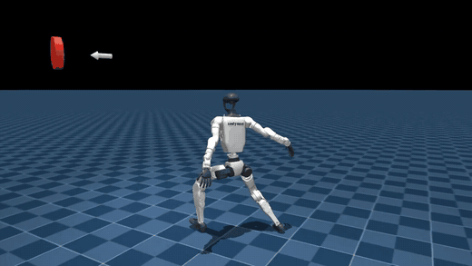
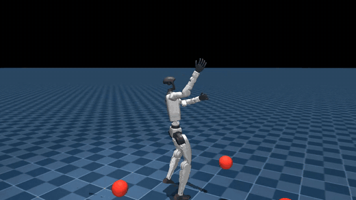
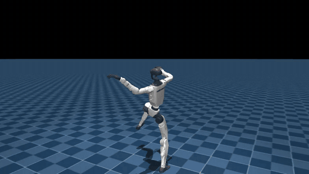
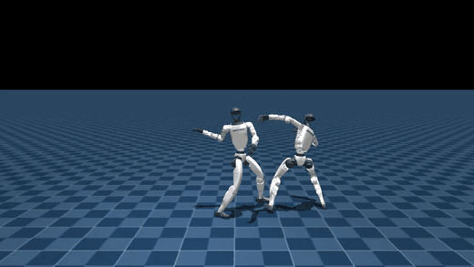

# Robot Fight League

Simulated humanoid fighters (Unitree G1 in MuJoCo) that learn to strike, kick, defend and spar from reward alone: no
motion capture in the training loop, no hand-animated moves. This repository is the working log of that project: the
training gyms, the experiments with their numbers, and the things that went wrong.

**Status (14 Nov 2026): work in progress.** The fighters stay on their feet, hit hard and trade with each other in
self-play. They do not yet look like trained fighters: the guard is loose, kicks rarely appear in a bout, and there is
no ring, get-up or referee count in the current fight gym. See [LOG.md](LOG.md) for where each of those stands.

| Single skills, one network each | Combo pads: choose target, limb and order |
|---|---|
|  |  |
|  |  |
| Strike (top) and kick (bottom) specialists | Combo pads (top), self-play bout (bottom) |

## What is here

| Path | What it is |
|---|---|
| `gyms/base` | Walking body with strength, injury and stamina handicaps; get-up gym |
| `gyms/strike` | Strike gym (one pad at a time), kick gym, and the **combo gym** (several pads at once, any limb) |
| `gyms/defence` | Defence gym: avoid or block a thrown ball |
| `gyms/fighter` | One network for four skills: train from scratch, widen a walking network, or copy four specialists into one |
| `gyms/spar` | Two-robot gyms: contact test, rule-switched bout, sparring against specialists, and the **fight gym** with self-play |
| `scripts` | Headless clip recorder, per-skill evaluation, bout scorecard, installer |
| `docs` | [Architecture](docs/architecture.html) and [training plan](docs/plan.html) as illustrated pages (open locally), clips |
| `motions` | An early, abandoned track: retargeting CMU motion capture to the G1 |

## How a hit is scored (fight gym)

`points = zone value x limb factor x impulse factor x variety factor`

- **Zone:** head 3, body 2, legs 1.
- **Limb:** fist 1.0, foot or shin 1.6.
- **Impulse:** momentum put into the opponent over the first 80 ms of contact; 3 N s earns nothing, 20 N s earns full marks.
- **Variety:** 0.6 for repeating the last zone with the same kind of limb, 1.3 otherwise.

A contact only counts if it is new, above 100 N, at that zone of the opponent's body, and the limb was closing on it
(1.5 m/s for a fist, 3 m/s for a leg). Every one of those conditions exists because a fighter found a way to score
without it; the log has the clips.

## Running it

Tested with [unitree_rl_mjlab](https://github.com/unitreerobotics/unitree_rl_mjlab) at commit `1425b15`, mjlab 1.2.0,
MuJoCo and MuJoCo Warp 3.5.0, rsl-rl-lib 5.0.1, PyTorch 2.15, Python 3.11, on a single NVIDIA T4 or L4.

```bash
# 1. set up unitree_rl_mjlab as its README describes, then:
./scripts/install.sh /path/to/unitree_rl_mjlab      # copies the gyms into src/tasks and the scripts next to them
cd /path/to/unitree_rl_mjlab

# 2. stage 1: combo pads, from scratch (about 2 h on an L4, 4.5 h on a T4)
python scripts/train.py G1-Combo-Legs --env.scene.num-envs=4096 --agent.logger tensorboard

# 3. stage 2: self-play from that network
mkdir -p logs/rsl_rl/g1_selfplay/seed && cp <combo checkpoint> logs/rsl_rl/g1_selfplay/seed/model_0.pt
FIGHT_RIVAL=<combo checkpoint> python scripts/train.py G1-SelfPlay --env.scene.num-envs=2048 --agent.logger tensorboard \
  --agent.resume True --agent.load-run seed --agent.load-checkpoint model_0.pt

# 4. record a clip of a fighter against itself
FIGHT_RIVAL=<checkpoint> MUJOCO_GL=egl python play_video.py 920 G1-SelfPlay --checkpoint_file=<checkpoint> \
  --num_envs 1 --video True --video_length 900 --video_width 1280 --video_height 720 --viewer viser
```

Trained networks from the log are attached to the repository's releases. The older gyms (`G1-Bout`, `G1-Sparring`)
expect four specialist networks in `~/teachers/` named `walk.pt`, `strike.pt`, `defend.pt`, `getup.pt`.

## Design in one paragraph

Each fighter is a small feed-forward network (three layers of 512, 256 and 128 units, about a quarter of a million
weights) that reads joint angles and speeds, body tilt and spin, its own last command, the positions of its targets and
of the opponent's fists and feet, and outputs 29 joint targets 50 times a second. Training is PPO over thousands of
simulated robots at once. The first design trained one network per skill, copied them into a single network and let a
hand-written rule pick the skill; it fell over a lot and fought reactively. The current design trains one network in a
gym where several targets are always visible, stance is paid continuously, and the opponent is a copy of itself.

## Credits and licences

Code in this repository is MIT licensed (see [LICENSE](LICENSE)). It builds on unitree_rl_mjlab, mjlab, MuJoCo, MuJoCo
Warp and rsl_rl, and uses the Unitree G1 model; see [THIRD_PARTY.md](THIRD_PARTY.md). The `motions` track used the CMU
Graphics Lab Motion Capture Database (mocap.cs.cmu.edu, created with funding from NSF EIA-0196217); the data itself is
not included here.
